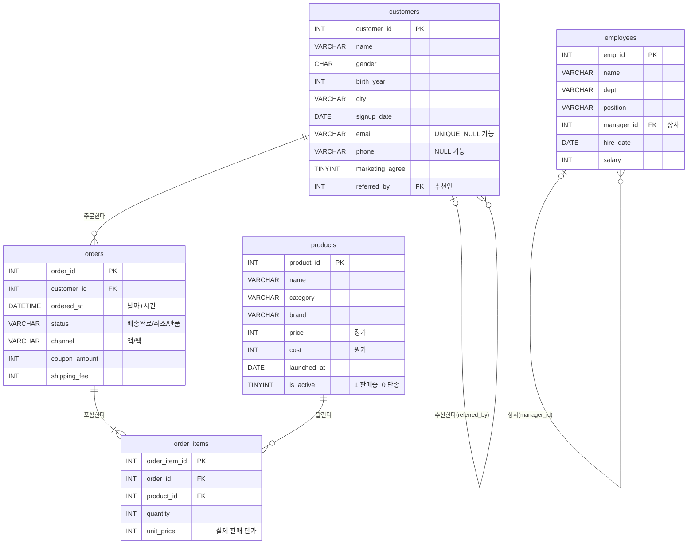

# 베라몰 DB 안내 (2단계부터 사용)

**베라몰**은 가상의 온라인 패션 편집숍입니다. 1단계 카페 DB(주문 18건)보다 훨씬 커서, 실무와 비슷한 규모로 서브쿼리·윈도우 함수를 연습할 수 있습니다.

| 테이블 | 행 수 | 내용 |
|---|---|---|
| `customers` | 300 | 고객 (가입일 2023~2025, 추천인 있음) |
| `products` | 36 | 상품 (6개 분류, 9개 브랜드, 정가·원가) |
| `orders` | 855 | 2025년 1년치 주문 (배송완료 / 취소 / 반품) |
| `order_items` | 1,380 | 주문 상세 (실제 판매 단가) |
| `employees` | 15 | 직원 (부서, 직급, 상사) |

> [!NOTE]
> 모든 이름·연락처·이메일은 **무작위로 만든 가상 데이터**입니다. GitHub에 올려도 괜찮습니다.

## 설치

1. DBeaver에서 `db/shop_schema.sql`을 열고 `Alt + X`(스크립트 실행).
2. 마지막 결과가 `300, 36, 855, 1380, 15`이면 성공.
3. 왼쪽 Database Navigator에서 연결을 새로고침(F5) → `shop` 데이터베이스 확인.
4. `shop`을 우클릭 → SQL 편집기 → 새 SQL 스크립트. (또는 `USE shop;`)

카페 DB(`cafe`)와 별도라서 서로 영향을 주지 않습니다. 언제든 다시 실행하면 처음 상태로 돌아갑니다.

## 테이블 관계 (ERD)

`||--o{`는 "하나 대 여럿"이라는 뜻입니다. 고객 1명은 주문을 0개 이상, 주문 1건은 상세를 1개 이상 가집니다.

## 카페 DB와 달라진 점 (중요)

| 항목 | 카페 DB | 베라몰 DB | 주의할 점 |
|---|---|---|---|
| 주문 시각 | `order_date` (DATE) | `ordered_at` (**DATETIME**) | 날짜 범위 조건을 쓸 때 시간까지 고려해야 함 (1강) |
| 판매 가격 | `menu.price` × 수량 | `order_items.unit_price` × 수량 | 할인 때문에 **정가(products.price)와 실제 판매가가 다름** |
| 주문 상태 | 없음 | `status` | 매출은 보통 **배송완료만**. 취소·반품을 빼지 않으면 매출이 부풀려짐 |
| 비회원 | 있음 (NULL) | 없음 (`customer_id NOT NULL`) | |
| 자기 참조 | 없음 | `referred_by`, `manager_id` | 같은 테이블끼리 JOIN (2강 SELF JOIN) |

## 용어 정리 (이 DB 기준)

| 용어 | 정의 |
|---|---|
| **매출** | `SUM(unit_price × quantity)`, `status = '배송완료'`만 |
| **결제금액** | 매출 − `coupon_amount` + `shipping_fee` (주문 단위) |
| **매출총이익(마진)** | `SUM((unit_price − cost) × quantity)` |
| **구매 고객** | 배송완료 주문이 1건 이상인 고객 |

실무에서도 "매출"의 정의는 회사마다 다릅니다. 분석을 시작하기 전에 **정의를 먼저 맞추는 것**이 시니어의 첫 번째 습관입니다.

Related: [2단계 목차](INDEX.md) · [환경 설정](../00_환경설정.md)
